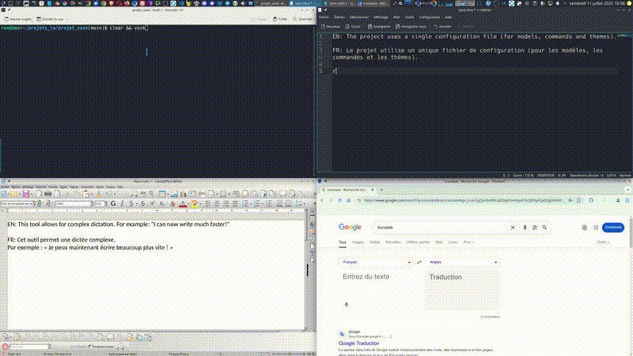

# Vosk-CLI-Dictation

<p align="center">
  <a href="https://github.com/RonanDavalan/vosk-cli-dictation/blob/main/LICENSE"></a>
  <a href="#"></a>
  <a href="#"></a>
  <a href="#"></a>
  <a href="#"></a>
</p>

<p align="center">
  <a href="https://vosk.davalan.fr/"><strong>➡️ Visit the Official Homepage for a full tour!</strong></a>
</p>

<p align="center">
  
</p>

A powerful and customizable command-line dictation tool for Linux, powered by the Vosk engine. Turn your speech into text directly in your terminal and have it appear in any application.

---

## ✨ Why This Project?

This tool was born from the need for a robust, locally-run dictation system on GNU/Linux that gives the user full control over their data and the software's behavior. Unlike cloud-based solutions, it operates **100% offline**, guaranteeing your privacy.

## 🚀 Key Features

*   **System-Wide Integration:** Dictate into any active application (terminal, browser, code editor, etc.).
*   **Multi-Language Support:** Works out-of-the-box with **English**, **French**, **German** and **Spanish**.
*   **Universal Control:** A running session is driven through a private Unix socket, so the same command bound to a desktop shortcut (`vosk-cli-dictation --toggle`, `--sleep`, `--status`) controls it on any desktop — native Wayland included. Global hotkeys via `pynput` remain as a convenience under plain X11.
*   **Fully Customizable:** Configure UI colors, shortcuts, voice trigger phrases, per-language typography and recognition aliases in a simple `config.yaml` file.
*   **Full Punctuation:** Dictate a complete range of punctuation with natural voice commands.
*   **Private and Offline:** Runs entirely on your machine. Your voice data never leaves your computer.

> [!NOTE]
>
> **X11 and Wayland support.** Text is injected by copying it to the clipboard and simulating a paste. Under Wayland the tool uses `wtype` and `wl-clipboard`, falling back to `ydotool` (which needs the `ydotoold` daemon and access to `/dev/uinput`, typically via the `input` group — `sudo usermod -aG input $USER`, then log out and back in). Under X11 it uses `xdotool`. At least one backend for the current session type must be installed; `vosk-cli-dictation --diagnose` reports what is available.
>
> **Global shortcuts.** `pynput` only sees key events under plain X11. On native Wayland, bind your desktop's own shortcut settings to the control subcommands (`vosk-cli-dictation --toggle`, `--finalize`, `--sleep-toggle`) — see *Controlling a running session* below. On Debian, `ydotool` is packaged in `trixie-backports`, not in stable.

## ⚙️ Getting Started

### 1. System Dependencies

This project was developed and tested on **Debian 12 (Bookworm)**. You will need the following packages:

```bash
sudo apt-get update && sudo apt-get install python3-pip python3-venv portaudio19-dev gettext xdotool pulseaudio-utils
```

For Wayland, install `wtype` and `wl-clipboard` (the preferred backend), and optionally `ydotool` as a fallback:

```bash
sudo apt-get install wtype wl-clipboard
# Optional fallback (enable trixie-backports first on Debian Trixie):
sudo apt-get install ydotool
sudo usermod -aG input $USER   # for ydotool only; log out and back in to take effect
```

After installing, `vosk-cli-dictation --diagnose` checks that a working injection backend, an audio input and the clipboard are all available.

### 2. Project Setup

Clone the repository and create the Python virtual environment.

```bash
git clone https://github.com/RonanDavalan/vosk-cli-dictation.git
cd vosk-cli-dictation
python3 -m venv venv
source venv/bin/activate
```

### 3. Install Python Dependencies

Install the required Python packages from the `requirements.txt` file.

```bash
pip install -r requirements.txt
```

### 4. Download Language Models

This project requires Vosk language models to function. They are not included in the repository and must be downloaded manually.

1.  **Download the models you need:** We recommend starting with the small models for efficiency. The factory `config.yaml` declares four:
    *   **English:** [vosk-model-small-en-us-0.15](https://alphacephei.com/vosk/models/vosk-model-small-en-us-0.15.zip)
    *   **French:** [vosk-model-small-fr-0.22](https://alphacephei.com/vosk/models/vosk-model-small-fr-0.22.zip)
    *   **German:** [vosk-model-small-de-0.15](https://alphacephei.com/vosk/models/vosk-model-small-de-0.15.zip)
    *   **Spanish:** [vosk-model-small-es-0.42](https://alphacephei.com/vosk/models/vosk-model-small-es-0.42.zip)

    You only need the ones you will actually use; a missing model is reported at startup, not fatal, as long as one language loads.

2.  **Unzip and place them correctly:** After unzipping, the model folders (e.g., `vosk-model-small-fr-0.22`) must be placed directly inside the `vosk-model/` directory of the project.

### 5. Launch The Application

With the virtual environment still active, run the main script.

```bash
# To run with the French model (default in config)
python3 src/main.py

# To explicitly run with another language
python3 src/main.py -l en      # also: fr, de, es

# To check that the environment is ready, without starting a session
python3 src/main.py --diagnose
```

Only one session runs per user at a time; a second launch is refused and points you at `--status`.

### 💡 Pro Tip: Create a Quick-Launch Command (Optional)

For easier access, you can add a function to your shell's configuration file (e.g., `~/.bashrc` or `~/.zshrc`).

1.  Open your configuration file: `nano ~/.bashrc`
2.  Add the following lines at the end. **Remember to replace `/path/to/your/vosk-cli-dictation` with the actual, absolute path to the project directory.**

    ```bash
    # Defines a 'vosk' command to launch the dictation script easily.
    vosk() {
        # Check if the project directory exists
        if [ -d "/path/to/your/vosk-cli-dictation" ]; then
            cd "/path/to/your/vosk-cli-dictation" && \
            source venv/bin/activate && \
            python3 src/main.py "$@" && \
            deactivate
        else
            echo "Error: Project directory not found at /path/to/your/vosk-cli-dictation"
        fi
    }
    ```

3.  Apply the changes by running `source ~/.bashrc` or by opening a new terminal.
4.  You can now launch the application from anywhere by simply typing `vosk` or `vosk -l en`.

## 🛠️ Usage & Configuration

### Language Selection

The language model is chosen based on the following priority:

1.  **Command-Line Flag (Highest Priority):** Use `-l en`, `-l fr`, `-l de` or `-l es` to force a specific language for the session.
2.  **Default in `config.yaml` (Fallback):** If no flag is used, the `default_model` from `config/config.yaml` is loaded.

### Voice Trigger Phrases

Each language has a two-word **wake phrase** and **stop phrase** (factory defaults: `start dictation` / `stop dictation` in English). Two words rather than one so an ordinary sentence never triggers them by accident. Say the wake phrase to start dictating, the stop phrase to finish and copy the result. Saying a phrase twice in a row (`stop dictation stop dictation`) types it literally instead of triggering. The phrases are configurable per language under `language_settings.<lang>.voice_commands`.

### Controlling a Running Session

The session opens a private Unix socket at `$XDG_RUNTIME_DIR/vosk-cli-dictation.sock` (mode `0600`). Running the **same command** with a control flag connects to it, performs the action, prints the state and exits:

```bash
vosk-cli-dictation --status          # -> OK ÉCOUTE
vosk-cli-dictation --toggle          # start/stop dictation
vosk-cli-dictation --sleep-toggle    # enter/leave sleep mode (releases the microphone)
vosk-cli-dictation --finalize        # stop and copy the accumulated text
vosk-cli-dictation --stop            # shut the session down
```

Bind these to your desktop's keyboard-shortcut settings (KDE, GNOME, Sway, labwc…) to get global control that works on native Wayland, where `pynput` cannot see key events. Under plain X11, the `pynput` hotkeys in the `hotkeys` section also work, as a convenience.

### Manual Commands

While the script is running in a terminal, you can also type these commands and press Enter:

*   `/cancel`: Stops the current recording session without outputting text.
*   `/delete-word`: Deletes the last typed word.
*   `/nl`: Inserts a new line (simulates pressing the Enter key).

### Customization

All settings can be modified in the `config/config.yaml` file: shortcuts, UI colors, voice trigger phrases, per-language typography, and recognition aliases. Corpus-specific alias examples live in `config/config.example.yaml`. See [`docs/configuration.md`](docs/configuration.md) for the full reference.

## 🤝 Contributing

This project is open source and contributions are highly encouraged! Please check out our **[Contribution Guide](CONTRIBUTING.md)** and feel free to open an issue on the [issues page](https://github.com/RonanDavalan/vosk-cli-dictation/issues).

This project is built through an asymmetric human-LLM collaboration — see [CONTRIBUTORS.md](CONTRIBUTORS.md) for the roles involved.

## 📄 License

This project is licensed under the **MIT License**. See the [LICENSE](LICENSE) file for details.