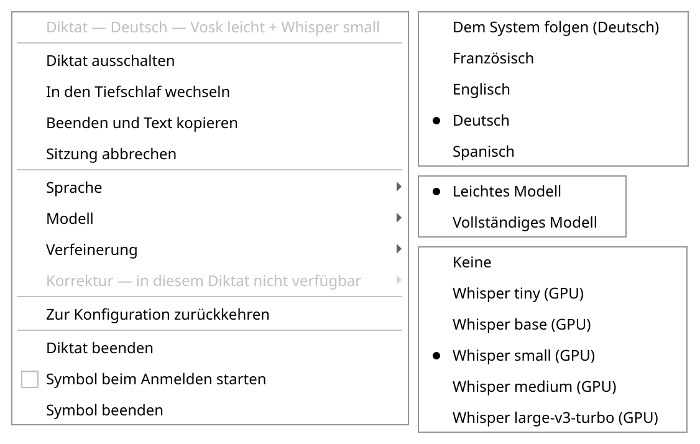

# Vosk-CLI-Dictation

<p align="center">
  <a href="https://github.com/RonanDavalan/vosk-cli-dictation/blob/main/LICENSE"></a>
  <a href="#"></a>
  <a href="#"></a>
  <a href="#"></a>
  <a href="#"></a>
</p>

[English](../../README.md) | [Français](../fr/README.md) | **Deutsch** | [Español](../es/README.md)

<p align="center">
  <a href="https://vosk.davalan.fr/"><strong>Besuchen Sie die offizielle Startseite für eine ausführliche Tour!</strong></a>
</p>

<p align="center">
  <a href="https://vosk.davalan.fr/"><strong>▶ Sehen Sie sich das Demonstrationsvideo auf der Startseite an</strong></a>
</p>

Ein leistungsfähiges und anpassbares Diktierwerkzeug für die Kommandozeile unter Linux, angetrieben von der Vosk-Engine. Verwandeln Sie Ihre Sprache direkt im Terminal in Text und lassen Sie ihn in jeder beliebigen Anwendung erscheinen.

---

## Warum dieses Projekt?

Dieses Werkzeug entstand aus dem Bedarf an einem robusten, lokal laufenden Diktiersystem unter GNU/Linux, das dem Benutzer die volle Kontrolle über seine Daten und das Verhalten der Software lässt. Anders als Cloud-Lösungen arbeitet es **zu 100 % offline** und garantiert so Ihre Privatsphäre.

## Hauptmerkmale

*   **Systemweite Integration:** Diktieren Sie in jede aktive Anwendung (Terminal, Browser, Code-Editor usw.).
*   **Mehrsprachig:** Funktioniert sofort mit **Englisch**, **Französisch**, **Deutsch** und **Spanisch**.
*   **Universelle Steuerung:** Eine laufende Sitzung wird über einen privaten Unix-Socket gesteuert; derselbe Befehl, an ein Desktop-Kürzel gebunden (`vosk-cli-dictation --toggle`, `--sleep`, `--status`), steuert sie auf jedem Desktop — auch unter nativem Wayland. Globale Tastenkürzel über `pynput` bleiben eine Komfortfunktion nach bestem Bemühen: Unter Wayland erreichen sie nur XWayland-Fenster, keine nativen Wayland-Fenster.
*   **Vollständig anpassbar:** Konfigurieren Sie Farben der Oberfläche, Tastenkürzel, Sprachauslöser, die Typografie je Sprache und Erkennungs-Aliase in einer einfachen Datei `config.yaml`.
*   **Vollständige Zeichensetzung:** Diktieren Sie das gesamte Spektrum der Satzzeichen mit natürlichen Sprachbefehlen.
*   **Privat und offline:** Läuft vollständig auf Ihrem Rechner. Ihre Stimme verlässt Ihren Computer nie.

> [!NOTE]
>
> **Unterstützung für X11 und Wayland.** Der Text wird eingefügt, indem er in die Zwischenablage kopiert und ein Einfügen simuliert wird. Unter Wayland verwendet das Werkzeug `wtype` und `wl-clipboard`, mit `ydotool` als Ersatz (das den Dienst `ydotoold` und Zugriff auf `/dev/uinput` braucht, in der Regel über die Gruppe `input` — `sudo usermod -aG input $USER`, danach ab- und wieder anmelden). Unter X11 verwendet es `xdotool`. Mindestens ein Backend für den aktuellen Sitzungstyp muss installiert sein; `vosk-cli-dictation --diagnose` zeigt, was verfügbar ist.
>
> **Globale Tastenkürzel.** `pynput` beobachtet den X-Server: Unter Wayland sieht es Tastenereignisse nur für Fenster, die über XWayland laufen (viele Electron- und ältere Anwendungen), nie für ein fokussiertes natives Wayland-Fenster. Es verbraucht die Ereignisse außerdem nicht — die Tastenkombination erreicht auch das fokussierte Fenster, sodass ihr Drücken beim Tippen in ein Terminal eine Escape-Sequenz einfügt (`^[s` für `Alt+S`). Für eine Steuerung, die überall funktioniert, binden Sie stattdessen die Kürzel-Einstellungen Ihres Desktops an die Steuer-Unterbefehle (`vosk-cli-dictation --toggle`, `--finalize`, `--sleep-toggle`). Siehe *Eine laufende Sitzung steuern* weiter unten. Unter Debian ist `ydotool` in `trixie-backports` paketiert, nicht in stable.

## Erste Schritte

### Das native Paket installieren (empfohlen)

Installieren Sie das für Ihre Distribution gebaute Paket von der
[Download-Seite](https://vosk.davalan.fr/) — keine manuelle Einrichtung, keine
virtuelle Umgebung anzulegen:

```bash
# Debian 12+ und Ableger (Ubuntu 24.04+, Mint 22+...)
sudo apt install ./vosk-cli-dictation_0.6.0~beta_all.deb

# Fedora
sudo dnf install ./vosk-cli-dictation-0.6.0~beta-1.fc42.noarch.rpm

# openSUSE (Leap)
sudo zypper install ./vosk-cli-dictation-0.6.0~beta-1.leap156.noarch.rpm

# Arch Linux
sudo pacman -U ./vosk-cli-dictation-0.6.0_beta-1-any.pkg.tar.zst
```

Bei der ersten Konfiguration des Pakets wird eine private virtuelle Umgebung aufgebaut und die Vosk-Engine darin installiert (dieser Schritt braucht Netzwerkzugriff).

Laden Sie dann ein Sprachmodell herunter und beginnen Sie zu diktieren:

```bash
vosk-cli-dictation --download-model fr   # auch: en, de, es
vosk-cli-dictation -l fr
```

Mit `--model-size big` laden Sie das vollständige Modell (`vosk-cli-dictation --download-model fr --model-size big`): je nach Sprache 1,4 bis 1,9 GB, und beim Entpacken wird etwa das Dreifache an freiem Speicherplatz benötigt.

Starten Sie das Werkzeug ohne installiertes Modell, bietet es den Download interaktiv an. Ein fehlendes Modell wird gemeldet, ist aber nicht fatal, solange eine Sprache geladen wird. Heruntergeladene Modelle werden per SHA256 geprüft und unter `~/.local/share/vosk-models/` abgelegt.

Das Paket zieht `xdotool` (X11) oder `ydotool` (Wayland-Ersatz) für die Texteingabe nach. Für natives Wayland installieren Sie zusätzlich das bevorzugte Backend mit dem Paketmanager Ihrer Distribution (Beispiel Debian):

```bash
sudo apt install wtype wl-clipboard
```

`ydotool` verlangt, dass Ihr Benutzer in der Gruppe `input` ist (`sudo usermod -aG input $USER`, danach ab- und wieder anmelden); `xdotool` und `wtype` nicht. Führen Sie `vosk-cli-dictation --diagnose` aus, um zu sehen, welches Backend, welcher Audioeingang und welcher Zwischenablage-Zugriff verfügbar sind.

> [!NOTE]
> Gibt `apt` eine Sandbox- oder `_apt`-Berechtigungswarnung aus, liegt das daran, dass sich das `.deb` in Ihrem Home-Verzeichnis befindet, das der Benutzer `_apt` nicht lesen kann. Kopieren Sie es zuerst nach `/tmp/` und installieren Sie es von dort. Die Installation gelingt in beiden Fällen.

### Aus den Quellen installieren (für die Entwicklung)

Dieser Weg führt den Code direkt aus einer Git-Arbeitskopie aus. Die unten genannten Systempakete sind die von Debian; unter Fedora, openSUSE oder Arch installieren Sie die Entsprechungen mit Ihrem Paketmanager.

```bash
sudo apt-get update && sudo apt-get install python3-pip python3-venv portaudio19-dev gettext xdotool pulseaudio-utils
# Wayland, optional: sudo apt-get install wtype wl-clipboard ydotool

git clone https://github.com/RonanDavalan/vosk-cli-dictation.git
cd vosk-cli-dictation
python3 -m venv venv
source venv/bin/activate
pip install -r requirements.txt
```

Laden Sie ein Modell herunter und starten Sie das Skript:

```bash
python3 src/main.py --download-model fr   # auch: en, de, es
python3 src/main.py -l fr                 # die Standardsprache kommt aus config.yaml
python3 src/main.py --diagnose            # die Umgebung prüfen, ohne eine Sitzung zu starten
```

Auf diese Weise heruntergeladene Modelle landen ebenfalls in `~/.local/share/vosk-models/`. Ersatzweise wird auch ein Modellordner (zum Beispiel `vosk-model-small-fr-0.22`) berücksichtigt, der direkt im Verzeichnis `vosk-model/` des Projekts liegt.

Pro Benutzer läuft immer nur eine Sitzung; ein zweiter Start wird abgelehnt und verweist auf `--status`.

### Tipp: einen Schnellstart-Befehl anlegen (optional)

Für den bequemeren Zugriff können Sie der Konfigurationsdatei Ihrer Shell (zum Beispiel `~/.bashrc` oder `~/.zshrc`) eine Funktion hinzufügen.

1.  Öffnen Sie Ihre Konfigurationsdatei: `nano ~/.bashrc`
2.  Fügen Sie am Ende die folgenden Zeilen hinzu. **Ersetzen Sie unbedingt `/path/to/your/vosk-cli-dictation` durch den tatsächlichen, absoluten Pfad zum Projektverzeichnis.**

    ```bash
    # Definiert einen Befehl 'vosk', der das Diktierskript einfach startet.
    vosk() {
        # Prüft, ob das Projektverzeichnis existiert
        if [ -d "/path/to/your/vosk-cli-dictation" ]; then
            cd "/path/to/your/vosk-cli-dictation" && \
            source venv/bin/activate && \
            python3 src/main.py "$@" && \
            deactivate
        else
            echo "Fehler: Projektverzeichnis nicht gefunden: /path/to/your/vosk-cli-dictation"
        fi
    }
    ```

3.  Übernehmen Sie die Änderungen mit `source ~/.bashrc` oder indem Sie ein neues Terminal öffnen.
4.  Sie können die Anwendung nun von überall starten, indem Sie einfach `vosk` oder `vosk -l en` eingeben.

## Verwendung und Konfiguration

### Sprachauswahl

Das Sprachmodell wird nach folgender Priorität gewählt:

1.  **Kommandozeilenoption (höchste Priorität):** Mit `-l en`, `-l fr`, `-l de` oder `-l es` erzwingen Sie eine bestimmte Sprache für die Sitzung.
2.  **Gemerkte Auswahl:** Eine Sprache oder ein Modell, das während einer laufenden Sitzung gewählt wird (`set-lang`, `set-model`, siehe unten), wird in `~/.local/state/vosk-cli-dictation/selection.yaml` gespeichert und beim nächsten Start wieder verwendet.
3.  **`default_model` in `config.yaml`:** ein Sprachcode oder `system` — der Werkswert, der auch gilt, wenn der Schlüssel fehlt —, das der Sitzungssprache folgt (`LC_ALL`, `LC_MESSAGES`, dann `LANG`), wenn ein Modell für diese Sprache installiert ist, andernfalls Englisch.

### Sprachauslöser

Jede Sprache hat eine **Weckphrase** und eine **Stopp-Phrase** aus zwei Wörtern (Werkseinstellung: `start dictation` / `stop dictation` im Englischen). Zwei Wörter statt eines, damit ein gewöhnlicher Satz sie nie versehentlich auslöst. Sagen Sie die Weckphrase, um mit dem Diktieren zu beginnen, die Stopp-Phrase, um das Ergebnis abzuschließen und zu kopieren. Wird eine Phrase zweimal hintereinander gesagt (`stop dictation stop dictation`), wird sie wörtlich getippt statt ausgelöst. Wird die Stopp-Phrase mit geringer Erkennungssicherheit gehört, wird sie verschluckt, statt in Ihr Dokument getippt zu werden — wiederholen Sie sie oder verwenden Sie `--finalize`. Die Phrasen sind je Sprache unter `language_settings.<lang>.voice_commands` konfigurierbar.

### Auslösemodi

`interaction.mode` (Standard `toggle`, gegenüber früheren Versionen unverändert) legt fest, wie eine Sitzung beginnt und endet: Eine Geste startet, eine andere beendet. Zwei weitere Modi: `maintenue` (Drücken-zum-Sprechen — das Diktat dauert, solange `hotkeys.push_to_talk` gedrückt bleibt) und `silence` (ein einziges Drücken startet; die Sitzung endet und kopiert sich selbst, sobald `interaction.silence_timeout_ms` ohne Ausgabe des Dekoders vergeht, nachdem ein Wort erfasst wurde). Die gesprochene Stopp-Phrase und `--finalize`/`--cancel` bleiben in jedem Modus als Sicherheitsnetz erhalten. Die vollständige Referenz steht in [`configuration.md`](configuration.md#interaction).

### Eine laufende Sitzung steuern

Die Sitzung öffnet einen privaten Unix-Socket unter `$XDG_RUNTIME_DIR/vosk-cli-dictation.sock` (Modus `0600`). Derselbe **Befehl** mit einer Steueroption verbindet sich mit ihm, führt die Aktion aus, gibt den Zustand aus und beendet sich:

```bash
vosk-cli-dictation --status          # -> OK ÉCOUTE
vosk-cli-dictation --info            # -> OK {"state":"ÉCOUTE","lang":"fr",…}  (vollständiger Zustand, eine JSON-Zeile)
vosk-cli-dictation --toggle          # Diktat starten/stoppen
vosk-cli-dictation --sleep-toggle    # Ruhemodus betreten/verlassen (gibt das Mikrofon frei)
vosk-cli-dictation --finalize        # anhalten und den angesammelten Text kopieren
vosk-cli-dictation --stop            # die Sitzung beenden
```

Binden Sie diese Befehle an die Tastenkürzel-Einstellungen Ihres Desktops (KDE, GNOME, Sway, labwc…), um eine globale Steuerung zu erhalten, die überall funktioniert, auch in den nativen Wayland-Fenstern, die `pynput` nicht sehen kann. Die `pynput`-Kürzel im Abschnitt `hotkeys` funktionieren ebenfalls als Komfortfunktion nach bestem Bemühen — unter Wayland nur über XWayland-Fenster.

### Sprache und Modell ohne Neustart wechseln

Eine laufende Sitzung wechselt Sprache oder Modell ohne Neustart, und der bereits getippte Text bleibt erhalten. Zwei Anfragen genügen: `set-lang fr|en|de|es|system` und `set-model <Modellordner>` (ein Ordnername aus der Liste `models`, die `--info` ausgibt). Das neue Modell wird im Hintergrund geladen, während das aktuelle weiterarbeitet, und ersetzt dieses zwischen zwei Äußerungen; schlägt das Laden fehl, bleibt das aktuelle Modell, und `last_error` in `--info` nennt den Grund. Die Auswahl wird in `selection.yaml` gespeichert (siehe Sprachauswahl). Die Anfragen gehen direkt an den Socket; jedes Werkzeug, das eine Zeile in einen Unix-Socket schreibt, genügt, hier `socat`:

```bash
printf 'set-lang en\n' | socat - UNIX-CONNECT:$XDG_RUNTIME_DIR/vosk-cli-dictation.sock   # -> OK ÉCOUTE
vosk-cli-dictation --info            # lang, model, models, loading, last_error…
```

Fehler: `ERR bad-argument` (unbekanntes Argument), `ERR no-model` (für die Anfrage ist kein Modell installiert), `ERR busy` (ein Modell wird gerade geladen). Eine dritte Anfrage ohne Argument, `reset-selection`, vergisst die gespeicherte Auswahl und kehrt zu dem zurück, was `config.yaml` oder die Systemsprache ergibt.

### Jede Äußerung mit Whisper verfeinern (optional)

Vosk zerlegt und zeigt den Text weiter beim Sprechen. Bei eingeschalteter Verfeinerung geht jede beendete Äußerung zusätzlich als Audio an `faster-whisper`, dessen Text mit Groß- und Kleinschreibung und Zeichensetzung den von Vosk unmittelbar vor dem Tippen ersetzt. Ein Befehlssatz (Stopp, Aufwecken) wird nie verfeinert; die Äußerungen werden in der Reihenfolge getippt, in der sie gesprochen wurden; und braucht Whisper nach dem Ende der Äußerung länger als `refine.timeout_ms` (2000 ms) oder liefert nichts Brauchbares, wird stattdessen der Text von Vosk getippt. `vosk-cli-dictation --status` (eine zweite Zeile), `--diagnose` und `--info` zählen diese Rückfälle. Solange `refine.engine` auf `none` steht, dem Werkswert, ändert sich nichts.

**Voraussetzung:** `faster-whisper` in der Python-Umgebung des Diktats: Das optionale Paket `vosk-cli-dictation-whisper` in derselben Version wie das Hauptpaket fügt es hinzu (`sudo apt install ./vosk-cli-dictation-whisper_0.6.0~beta_all.deb`; dieselben Dateinamen mit `-whisper` unter Fedora, openSUSE und Arch), oder `pip install faster-whisper` aus einer Git-Kopie. Ohne es graut das Menü des Symbols den Eintrag mit diesem Grund aus, und `--diagnose` sagt es ebenfalls. Die Gewichte werden beim ersten Gebrauch unter `~/.local/share/vosk-cli-dictation/whisper-models` geladen (etwa 75 MB für `tiny`, 1,6 GB für `large-v3-turbo`); das Symbol kündigt den ersten Download an, und währenddessen wird der Text von Vosk getippt.

```yaml
refine:
  engine: whisper      # none (Werkswert) | whisper
  model: auto          # auto | tiny | base | small | medium | large-v3-turbo
  device: auto         # auto | cpu | cuda
  compute_type: auto   # auto: float16 auf cuda, int8 auf cpu
  timeout_ms: 2000
```

*   **Auf einer Grafikkarte (NVIDIA):** CTranslate2 braucht die CUDA-12-Bibliothek `libcublas.so.12` (Debian und Ubuntu: `sudo apt install libcublas12 libcublaslt12`). `device: auto` nutzt die Karte, wenn sie erkannt wird und die Bibliothek sich laden lässt; eine Karte ohne die Bibliothek fällt auf den Prozessor zurück, und das Diktat gibt dieses Rezept aus; `device: cuda` wird dann mit demselben Rezept abgelehnt. `--diagnose` zeigt die gewählte Hardware und den Zustand der Bibliothek. `model: auto` ergibt `large-v3-turbo`, die größte Größe, deren Latenz im 95. Perzentil pro Äußerung unter 500 ms bleibt (etwa 310 ms auf einer RTX 3060).
*   **Auf einem Prozessor:** keine Größe bleibt unter 500 ms pro Äußerung (`tiny` braucht im 95. Perzentil 3,4 s auf einem Raspberry Pi 4 und 1,3 s auf einem x86 mit 8 Kernen), und `tiny` wie `base` verderben den französischen Text. `model: auto` ergibt dort daher keine Verfeinerung; wählen Sie eine Größe von Hand in `config.yaml` oder im Menü des Symbols und erhöhen Sie `timeout_ms` entsprechend. Ein Kern bleibt Vosk vorbehalten.
*   **Was zu erwarten ist:** auf dem Benchmark des Projekts mit synthetischer Sprache (er vergleicht Engines, er verspricht keine echte Rate) sinken die Wortfehler im Französischen von 15,4 % auf 12,0 % mit dem leichten Vosk-Modell und `large-v3-turbo`; mit dem vollständigen Vosk-Modell werden die Wörter nicht besser (10,1 % gegenüber 12,2 %), und die Verfeinerung bringt vor allem Groß- und Kleinschreibung und Zeichensetzung.

Eine laufende Sitzung ändert die Verfeinerung ohne Neustart, über das Menü des Symbols oder den Socket: `set-refine whisper:small` oder `set-refine none`. Die Größe wird im Hintergrund geladen, während der Text von Vosk getippt wird; die Auswahl wird in `selection.yaml` gespeichert (Schlüssel `refine`), und `reset-selection` kehrt zur Konfiguration zurück. Fehler: `ERR bad-argument` (unbekannte Größe), `ERR busy` (ein Ladevorgang läuft), `ERR unsupported` (`faster-whisper` fehlt). `--info` liefert `refine`, `refine_options`, `refine_reason`, `device`, `refine_download` und `refine_stats` (`done`, `timeout`, `error`, `rejected`, `skipped`, `mean_ms`).

### Manuelle Befehle

Solange das Skript in einem Terminal läuft, können Sie auch diese Befehle eingeben und die Eingabetaste drücken:

*   `/cancel`: Beendet die laufende Aufnahmesitzung, ohne Text auszugeben.
*   `/delete-word`: Löscht das zuletzt getippte Wort.
*   `/nl`: Fügt einen Zeilenumbruch ein (simuliert die Eingabetaste).

### Symbol im Benachrichtigungsbereich (optional)

`vosk-cli-dictation-tray` ist ein eigenständiges Programm (Python und PySide6), das ein Mikrofon im Benachrichtigungsbereich zeigt und die laufende Sitzung über ihren Steuer-Socket bedient. Das Diktat braucht es nie und läuft ohne es genauso. Farbe und Form geben den Zustand an, sodass das Symbol auch für Farbfehlsichtige lesbar bleibt:

*   **rotes Mikrofon mit Schallwellen**: `DICTÉE`, die Stimme wird getippt;
*   **orangefarbenes Mikrofon**: `ÉCOUTE`, das Mikrofon ist offen, das Diktat ist aus, die Weckphrase wird erwartet;
*   **blaues Mikrofon unter einer Mondsichel**: `VEILLE`, das Mikrofon ist freigegeben;
*   **grünes Mikrofon als Umriss**: kein Diktat läuft; ein Klick startet es.

Ein Linksklick startet das Diktat, wenn es aus ist, und schaltet es sonst um. Das Menü des Rechtsklicks startet oder beendet das Diktat, versetzt es in den Tiefschlaf oder weckt es, beendet und kopiert den Text, bricht die Sitzung ab und wählt die Sprache (dem System folgen oder eine der vier; eine Sprache ohne Modell ist als „zum Herunterladen“ markiert), das Modell (leicht oder vollständig, mit seiner Größe, wenn es fehlt; der Download startet im Menü und eine Benachrichtigung meldet sein Ende), die Verfeinerung durch Whisper (angeboten, wenn `faster-whisper` installiert ist, sonst mit ihrem Grund ausgegraut; beim ersten Gebrauch einer Größe werden ihre Gewichte geladen, und eine Benachrichtigung meldet Anfang und Ende) und die Korrektur (ausgegraut, mit ihrem Grund, solange das laufende Diktat sie nicht ankündigt), dann „Zur Konfiguration zurückkehren“, das Sprachdiktat aktivieren oder beenden, „Symbol beim Anmelden starten“ (ein XDG-Autostart-Eintrag) und das Symbol beenden. Das vom Symbol gestartete Diktat läuft ohne Terminal; seine Ausgabe geht nach `~/.local/state/vosk-cli-dictation/instance.log`. Auf einem Desktop ohne Benachrichtigungsbereich (GNOME ohne Erweiterung) sagt das Symbol einmal per Desktop-Benachrichtigung, wie „AppIndicator and KStatusNotifierItem Support“ aktiviert wird; die obigen Steuer-Unterbefehle funktionieren weiter.

<p align="center">
  
</p>

Mit den nativen Paketen ist das Symbol ein zweites Paket in derselben Version wie das Hauptpaket:

```bash
# Debian 12+, Ubuntu 24.04+, Mint 22+...
sudo apt install ./vosk-cli-dictation-tray_0.6.0~beta_all.deb
# Fedora
sudo dnf install ./vosk-cli-dictation-tray-0.6.0~beta-1.fc42.noarch.rpm
# openSUSE Leap
sudo zypper install ./vosk-cli-dictation-tray-0.6.0~beta-1.leap156.noarch.rpm
# Arch Linux
sudo pacman -U ./vosk-cli-dictation-tray-0.6.0_beta-1-any.pkg.tar.zst
```

Ihre Grafikbibliothek PySide6 wird bei der ersten Konfiguration mit `pip` in eine private virtuelle Umgebung installiert (nur dann ist Netzzugriff nötig); das Paket fügt außerdem einen Menüeintrag und einen Systemeintrag für die Anmeldung hinzu („Symbol beim Anmelden starten“ im Menü abzuwählen entfernt ihn für das eigene Konto). Aus einer Git-Kopie:

```bash
cd ~/git/vosk-cli-dictation/vosk-cli-dictation/tray
python3 -m venv venv && venv/bin/pip install -e .
venv/bin/vosk-cli-dictation-tray
```

Optionen: `--socket PFAD` (den Socket eines anderen Diktats bedienen), `--dictation-command BEFEHL` (wie das Symbol das Diktat startet), `--version`. Siehe `man vosk-cli-dictation-tray` (`docs/de/vosk-cli-dictation-tray.1.md`).

### Anpassung

Alle Einstellungen lassen sich in der Datei `config/config.yaml` ändern: Tastenkürzel, Farben der Oberfläche, Sprachauslöser, Typografie je Sprache und Erkennungs-Aliase. Beispiele für korpusspezifische Aliase stehen in `config/config.example.yaml`. Die vollständige Referenz steht in [`configuration.md`](configuration.md).

## Mitwirken

Dieses Projekt ist quelloffen, und Beiträge sind ausdrücklich willkommen! Lesen Sie unseren **[Beitragsleitfaden](../../CONTRIBUTING.md)** und eröffnen Sie gern ein Ticket auf der [Ticket-Seite](https://github.com/RonanDavalan/vosk-cli-dictation/issues).

Dieses Projekt entsteht in einer asymmetrischen Zusammenarbeit von Mensch und LLM — die beteiligten Rollen stehen in [CONTRIBUTORS.md](../../CONTRIBUTORS.md).

## Danksagungen

Dieses Projekt entsteht in einer Zusammenarbeit von Mensch und LLM; die Rollen sind so festgehalten, wie sie tatsächlich ausgeübt wurden. Die vollständige Liste steht in [CONTRIBUTORS.md](../../CONTRIBUTORS.md).

*   **Ronan Davalan** — Architekt und Schiedsrichter: Vision, Sicherheitsanforderungen, Abnahme und Tests.
*   **Claude Code (Anthropic)** — Systemingenieur und Hauptentwickler: Hauptautor des Quellcodes, der Debian-Paketierung und der Werkzeuge.
*   **Gemini (Google)** — Synthetisierer und strategischer Berater.
*   **Grok (xAI)** — Externer Validator.
*   **GLM-5.3** — Prüfer des Interaktionskerns (blindes Kreuz-Audit).
*   **DeepSeek V4 Flash (über OpenCode)** — Prüfer der Dokumentation und der Website, Tester.

## Lizenz

Dieses Projekt steht unter der **MIT-Lizenz**. Einzelheiten stehen in der Datei [LICENSE](../../LICENSE).
